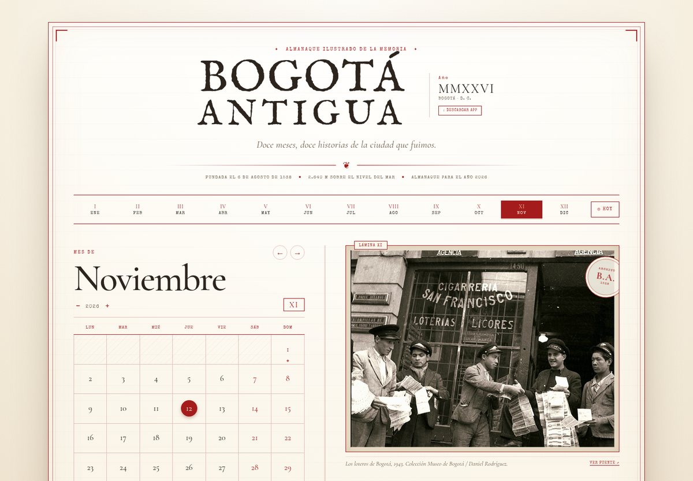

# Bogotá Antigua

Calendario editorial ilustrado con doce historias y fotografías de archivo de Bogotá. Está hecho con **HTML, CSS y JavaScript puro**: no tiene build, dependencias ni base de datos.



## Qué incluye

- Calendario real que abre en el mes actual y resalta el día de hoy.
- Doce meses, cada uno con una historia distinta y una fotografía de archivo.
- Navegación por mes y año, botón **Hoy**, efemérides y fechas destacadas.
- Animación de cambio de mes con un giro de página antigua.
- Botón **Descargar app**: entrega una copia autónoma con las fotos y tipografías incluidas, para abrirla sin internet.
- Láminas ampliables, créditos, enlace a la fuente e impresión.
- Diseño responsive para celulares, tabletas, laptops y pantallas horizontales.
- Carga por demanda: primero la lámina del mes y luego el resto en segundo plano.
- Respeta `prefers-reduced-motion` para quienes prefieren menos animaciones.

## Cómo verlo

Abre `index.html` directamente en el navegador, o levanta un servidor local:

```bash
python3 -m http.server 8000
```

Luego visita `http://localhost:8000`.

> Las fotografías se cargan desde archivos públicos de Radio Nacional de Colombia / Señal Memoria y Wikimedia Commons, así que la primera visita necesita conexión a internet. Después el navegador las conserva en caché.

## Estructura

```
.
├── index.html                 # aplicación completa (versión conectada)
├── bogota-antigua-offline.html # copia autónoma con fotos y fuentes incrustadas
├── docs/
│   └── preview.jpg            # captura de referencia
└── README.md
```

## Descarga local

El botón **Descargar app** de la versión publicada descarga `bogota-antigua-offline.html` como `Bogota-Antigua.html`. Esa copia pesa alrededor de 3,7 MB porque lleva las doce fotografías y las tipografías incrustadas en el propio archivo: se puede abrir con doble clic y funciona sin conexión.

La versión `index.html` es la que se sirve en la web; mantiene las imágenes remotas para cargar rápido y descarga la copia autónoma cuando el usuario la pide. Si se abre `index.html` directamente desde el disco sin el archivo offline al lado, el botón genera una copia de la app actual.

## Despliegue

Es un sitio estático. En Vercel basta con importar el repositorio y desplegar; no requiere framework ni comando de build.

## Créditos

Textos y fotografías de archivo: [Radio Nacional de Colombia / Señal Memoria](https://www.radionacional.co/cultura/historia-colombiana/galeria-la-bogota-de-antano-un-recorrido-por-la-capital), Colección Museo de Bogotá, Colección Banco de la República y [Wikimedia Commons](https://commons.wikimedia.org/).

Pieza editorial sin fines comerciales; las imágenes conservan sus créditos originales.
